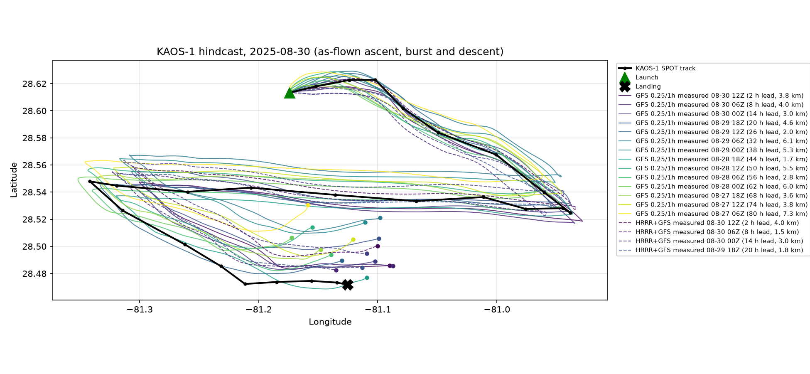
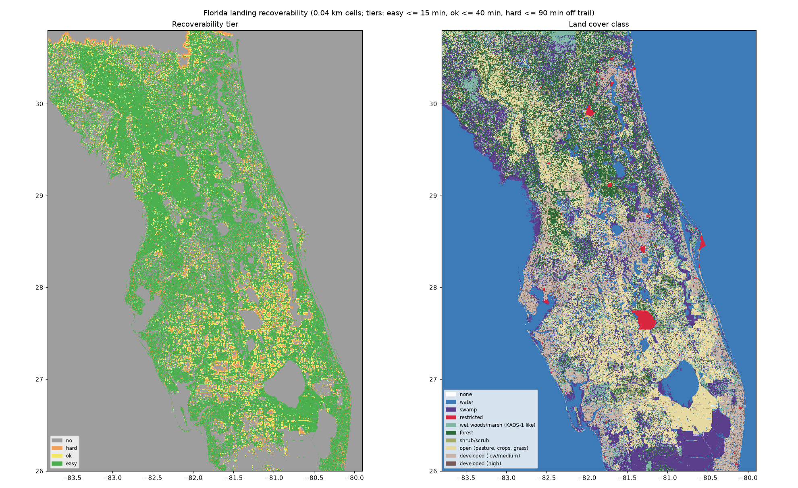
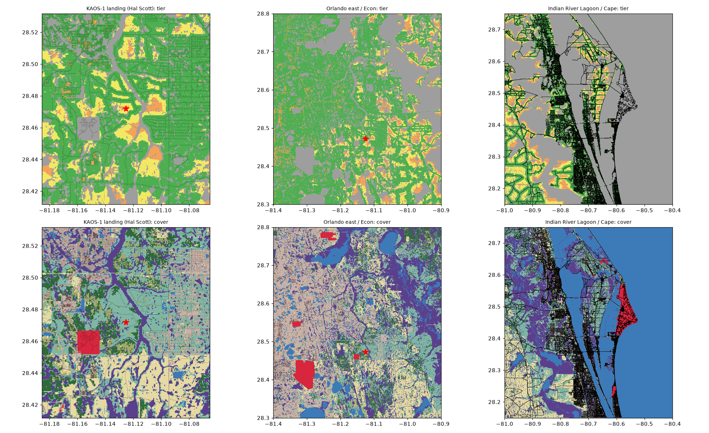
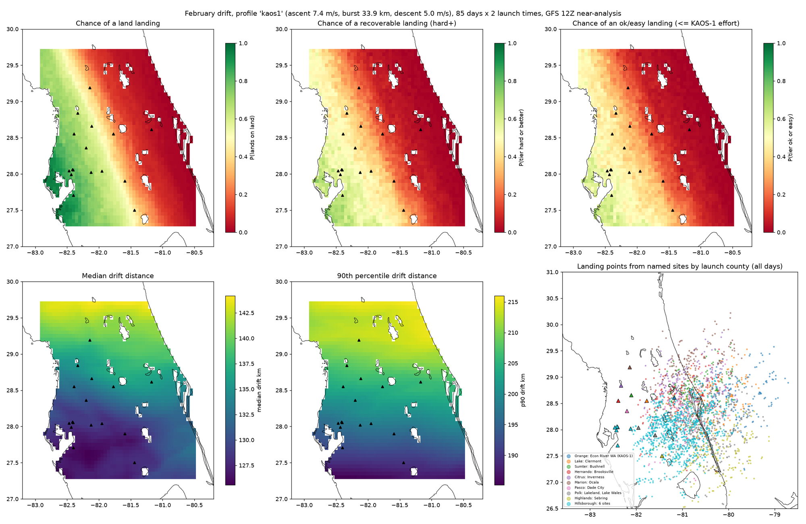
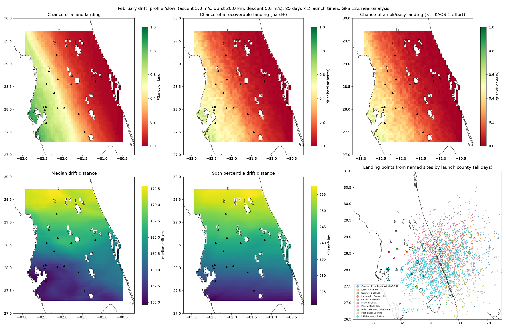

# hab-predictor

High altitude balloon flight prediction tools from the Knights Satellite Club.

The flight model matches [Tawhiri](https://github.com/cuspaceflight/tawhiri), the
predictor behind SondeHub: horizontal motion follows the forecast wind, ascent is at
a set rate to a burst altitude, and descent speed scales with air density. It is
written from the published equations (not Tawhiri's code) in Python and Numba. It adds:

- GFS 0.25 deg hourly winds (49 levels up to 1 hPa), and HRRR 3 km below 20 km
  blended into GFS above;
- ascent and descent rates that can vary with altitude (tables), for hindcasts from
  logged flights and for balloon physics later;
- a parallel batch solver for Monte Carlo runs and launch-site grids.

Plan and research notes: KAOS-2 Notion, "HAB landing prediction: research and plan".

## Setup

```sh
uv sync --all-extras
uv run pytest
```

Downloaded weather data is cached under `data/` (override with `HABPRED_DATA`).
A GFS forecast hour cropped to Florida is ~1 MB on disk (~140 MB downloaded); an
HRRR hour is ~75 MB on disk (~76 MB downloaded). Data comes from NOAA's open data
buckets on AWS (`noaa-gfs-bdp-pds`, `noaa-hrrr-bdp-pds`), which hold years of archive.

## Predict a flight

```sh
uv run habpred predict --lat 28.6134 --lon -81.1742 --alt 20 \
    --time 2026-11-26T15:00Z --ascent 5 --burst 30000 --descent 5 [--hrrr] [--csv out.csv]
```

`--descent` is the sea-level descent rate. `--cycle` picks a GFS run (default: latest).

From Python:

```python
from habpred.sources import gfs
from habpred.solver import predict, predict_many

wind = gfs.load(cycle, launch_time, launch_time + timedelta(hours=5))
flight = predict(wind, launch_time, lat, lon, launch_alt, 5.0, 30000.0, 5.0)
landings = predict_many(wind, t0s, lats, lons, alt, ascent, burst, descent, ground)
```

## Validation so far

`scripts/kaos1_hindcast.py`: KAOS-1 (2025-08-30) re-run with the forecasts that
were available 2 to 80 hours before launch, using the measured ascent and descent
profile (SPOT track and onboard pressure log). Landing errors: GFS 1.7 to 7.3 km,
HRRR+GFS 1.5 to 4.0 km (2 to 20 h lead). KAOS-1 drifted only 16 km, so this is one
calm summer case, not a statistic.



`scripts/sonde_hindcast.py`: 577 Florida radiosondes (Dec 2025 to Mar 2026, Tampa
Bay, Cape Canaveral, Jacksonville and Miami) re-run from their first fix with GFS
forecasts issued 3, 27 and 51 hours before launch, scored at the last fix heard on
descent. Median drift 140 km.

| Forecast lead | Error, sonde's own climb profile (median / 90th pct) | Error, constant climb rate |
|---|---|---|
| 6 h | 4.1 / 8.0 km (2.9% of drift) | 6.8 / 15.1 km |
| 30 h | 6.4 / 12.4 km (4.5%) | 8.3 / 17.9 km |
| 54 h | 10.5 / 21.3 km (7.3%) | 11.9 / 25.9 km |

Using one mean climb rate costs about as much as two extra days of forecast lead,
so the shape of the ascent profile matters in winter jet conditions.

`scripts/compare_sondehub.py`: same inputs as the SondeHub predictor on the same GFS
cycle. With Tawhiri-like settings (0.5 deg, 3-hourly, 60 s steps) landings agree to
1.1 to 1.6 km over 135 to 189 km of drift (about 1%), with identical flight times.

## Landing recoverability raster

`scripts/build_recover.py` builds a ~40 m raster of the peninsula (26.0-30.8 N,
83.8-79.9 W) that says whether a landing spot is recoverable. Inputs, all public:

| Source | Use | Get it |
|---|---|---|
| NLCD 2021 land cover | Base cover class and walking pace | fetched automatically (MRLC WCS) |
| National Wetlands Inventory | Swamp vs passable wet ground (water regime) | `data/nwi/FL_geodatabase_wetlands.zip` from the [USFWS state downloads](https://www.fws.gov/program/national-wetlands-inventory/download-state-wetlands-data) |
| OpenStreetMap (Geofabrik) | Roads, tracks and paths; military, airports, prisons, launch complexes | `data/osm/florida-latest.osm.pbf` from [Geofabrik](https://download.geofabrik.de/north-america/us/florida.html) |

Rules, calibrated on the KAOS-1 recovery (Hal Scott: ~300 m off trail took 30 min
through wet flatwoods that NLCD calls "woody wetlands" but NWI leaves unmapped):

- **Swamp (not recoverable):** NWI palustrine wetlands that are seasonally flooded
  or wetter (regimes C, E, F, G, H, K...), tidal marsh and mangrove. Temporarily
  flooded or saturated wetlands (A, B, J) are passable wet ground like KAOS-1's.
- **Walking time** from the nearest road, track or path (least-cost path that avoids
  swamp, water and restricted areas). Pace in min/km: wet ground 100, scrub 60,
  forest 40, open 20, developed 15.
- **Tiers:** easy <= 15 min, ok <= 40 min (KAOS-1 plus margin; the raster puts it at
  36 min), hard <= 90 min, otherwise no. Thresholds are applied on load, no rebuild needed.
  Dense urban is capped at hard (roofs, power lines). Water, swamp and restricted
  ground are no.

Outputs: `data/masks/recover_*.npz` (loaded by `habpred.recover.Recoverability`)
and GeoTIFFs plus PNG maps in `out/recover/`. Private land is not modelled: most
dry land is somebody's ranch, so a landing there means asking permission.

Raster limits: building needs ~24 GB RAM (desktop, not the VPS). Every OSM
aerodrome counts as restricted, including ranch grass strips. Kennedy Space Center
outside the named launch complexes is not restricted, because OSM maps it as one
area with the public wildlife refuge. Trail length isn't limited (Hal Scott was
~5 km on trail).



Close-ups: the KAOS-1 landing at Hal Scott (red star), east Orlando and the Econ
River, and the Indian River Lagoon and Cape. Dots are mapped roads and trails.



## February launch sites

`scripts/feb_drift.py` flies a 0.05 deg grid of launch sites plus named sites on
every February day of 2024 to 2026 (GFS 12Z near-analysis, 9 and 11 am EST launches)
and scores each landing against the recoverability raster. Profiles: `kaos1`
(7.4 m/s ascent, 33.9 km burst) and `slow` (5 m/s, 30 km).

| Launch site | Lands on land | Ok/easy, kaos1 | Ok/easy, slow | Median drift (kaos1 / slow) |
|---|---|---|---|---|
| Econ River (KAOS-1) | 4% | 2% | 3% | 136 / 166 km |
| Brooksville | 73% | 42% | 34% | 132 / 165 km |
| MOSI | 82% | 52% | 41% | 129 / 158 km |
| Adams Middle | 82% | 46% | 49% | 129 / 158 km |
| Ruskin NWS | 87% | 54% | 39% | 126 / 155 km |
| Best Bradenton/Sarasota cells | 90-96% | 65-71% | 49-60% | ~125 / ~155 km |

"Ok/easy" means no harder to reach than KAOS-1. With 170 launches per site the
percentages are good to about +/-4 points. The full table is in
`out/feb/named_sites.csv`.



<details><summary>Slow profile (5 m/s, 30 km burst)</summary>



</details>

Pictures in `docs/img/` are snapshots; rerun the scripts and copy from `out/` to
refresh them.

## Layout

| Path | What |
|---|---|
| `src/habpred/wind.py` | Wind field container and 4-D interpolation (lat/lon and Lambert grids) |
| `src/habpred/solver.py` | RK4 flight integration, single and parallel batch |
| `src/habpred/atmosphere.py` | Density model for descent-rate scaling |
| `src/habpred/sources/` | GFS and HRRR downloaders (byte-range GRIB from AWS) |
| `src/habpred/sondehub.py` | SondeHub API client, for comparisons only |
| `src/habpred/recover.py` | Landing recoverability raster (build and lookup) |
| `src/habpred/landmask.py` | Coarse Natural Earth land/water mask |
| `scripts/` | Hindcasts and comparisons |

## Known limits

- Ground is a constant altitude (no elevation model yet). Florida is flat, so this
  costs tens of metres.
- No uncertainty estimate yet: one deterministic path per forecast.
